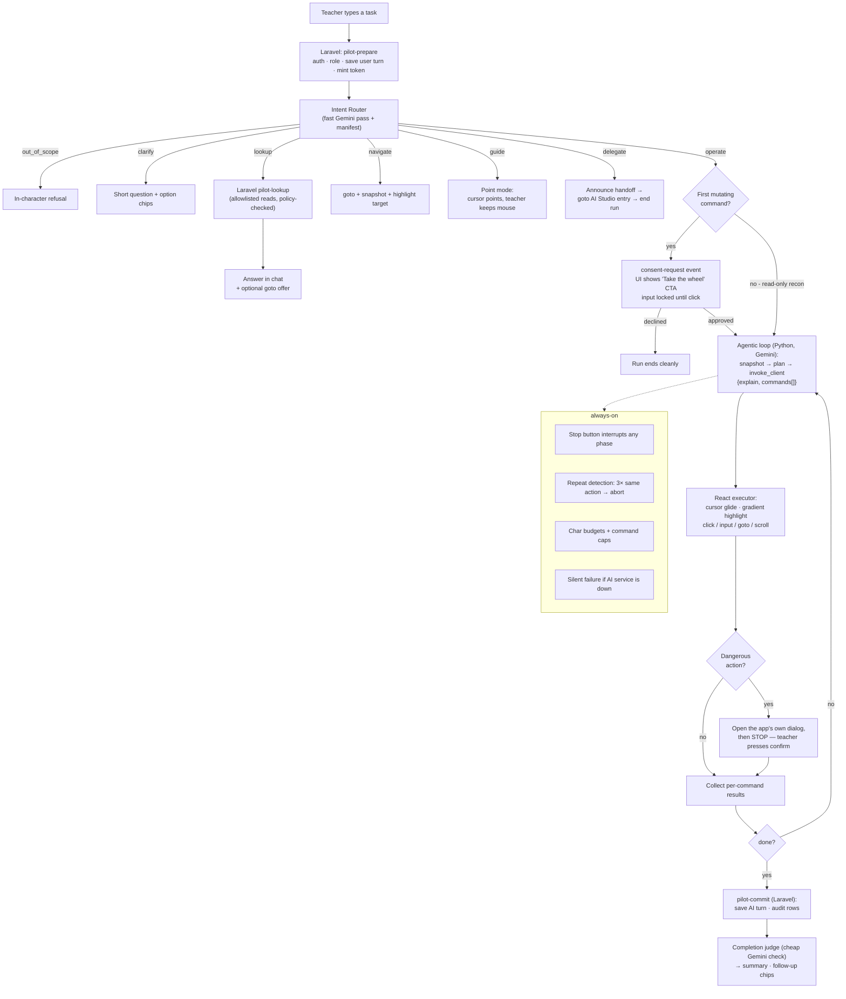
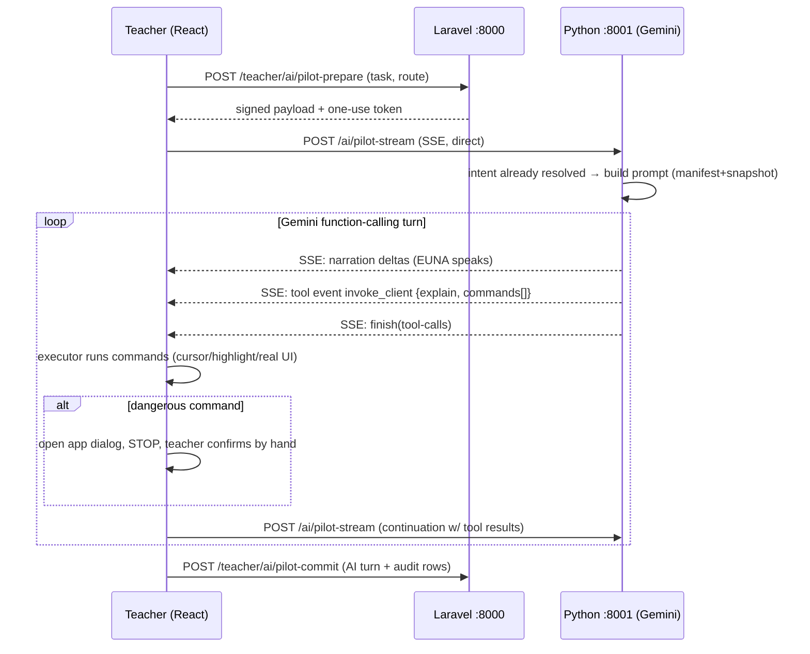

# EUNA Pilot — end-to-end implementation plan

Companion docs: `docs/euna-pilot-report.md` (Tencent teardown evidence) ·
`docs/euna-pilot-proposal.md` (executive summary for sign-off).

**Scope note (user decision):** we are NOT copying Tencent's stack — only the feature:
*an AI that can control the teacher's browser, feel alive doing it, and know exactly
what it can and cannot do.* Our boundaries are our own, and the biggest one is:

> **EUNA Pilot never generates learning content.** Lessons, modules, quizzes, challenge
> code, questions — that is the AI generation studio's job (architect → design modal →
> review → console). The Pilot navigates, reads, explains, and operates simple flows.
> When a task belongs to the studio, the Pilot says so and hands off.

---

## 1. The core problem you asked about: "how will it know?"

A model with a browser tool and no map will hallucinate menus. We give it knowledge in
four layers. Each layer is small, reviewable, and testable — no magic.

### 1.1 Layer 1 — The Capability Manifest (the source of truth)

A versioned config file in the repo: `instruct-ai-service/config/pilot_capabilities.py`
(consumed by the Python service; a generated JSON mirror ships to the frontend for the
UI's "what can I ask" hints).

Structure (abbreviated):

```python
ROUTES = {
  "/dashboard/teacher": {
    "title": "Overview",
    "purpose": "See all your classes, due-soon items, quick stats.",
    "can": ["navigate", "read"],
  },
  "/dashboard/teacher/class/:classId": {
    "title": "Class page",
    "purpose": "Manage one class: stream, classwork, people, grades.",
    "tabs": {
      "classwork": "Activities and modules for this class.",
      "people":    "Roster: enrolled students, remove students.",
      "grades":    "Gradebook per activity and student.",
    },
    "actions": ["open_activity", "remove_student*", "open_grades"],
  },
  # ... every teacher route, generated from App.jsx router config
}

ACTIONS = {
  "remove_student*": {
    "where": "/dashboard/teacher/class/:classId (People tab)",
    "risk": "dangerous",            # * suffix = agent may never press the final confirm
    "say": "Remove {student} from {class}.",
    "preconditions": ["student is in roster"],
  },
  "open_ai_studio": {
    "where": "class page → Classwork tab → Create/Create with AI",
    "risk": "delegated",            # hands off to the AI generation studio
    "say": "Content generation happens in the AI Studio; I'll take you there and set it up.",
  },
}

CANNOT = [
  "Generate or edit lesson/quiz/challenge content (AI Studio's job — delegate, never imitate).",
  "Anything outside the teacher dashboard (admin whitelist, student pages, billing, landing).",
  "Another teacher's classes (server policies block this regardless).",
  "Press destructive confirm buttons — the teacher's own click always finishes those.",
]
```

**How it stays true:** a small build-time check (`tools/pilot/manifest-lint.mjs`) parses
the route table out of `frontend/src/App.jsx` and fails CI if a teacher route has no
manifest entry. When a page is redesigned, its manifest entry is reviewed in the same
PR — same discipline as the CSS-architecture rule.

### 1.2 Layer 2 — The Intent Router (the traffic cop)

Every teacher message first goes through one **fast, non-streamed Gemini call** (same
"planner pass" pattern the tutor already uses) with the manifest summary (~2.5k chars)
and returns strict JSON:

```json
{
  "intent": "operate | navigate | lookup | guide | delegate | out_of_scope | clarify",
  "target": "class:3a / student:Anna / quiz:null",
  "needs": "one of: none, data, page_state",
  "clarify_question": null
}
```

| Intent | Means | Example (your questions) |
|---|---|---|
| `lookup` | Answer from data; no UI theater needed | "Is there a student named Andrew in my class?" |
| `navigate` | Just take me there | "Show me Anna's grades" (goto + highlight her row) |
| `guide` | Walk me through it; teacher keeps the mouse | "How do I kick a student?" |
| `operate` | Do it through the real UI (consent-gated) | "Remove Andrew from my class", "Delete this class" |
| `delegate` | Belongs to another subsystem — announce + hand off | "Make a quiz about photosynthesis" |
| `out_of_scope` | Refuse in character | "Book me a flight to Cebu" |
| `clarify` | Ambiguous → one short question + chips | "Show me his grades" (who?) |

This single classification is what makes "make a quiz" route to the AI Studio while
"show Anna's grades" routes to lookup — the model never has to guess policy, because
policy lives in the manifest and the router only picks a lane.

### 1.3 Layer 3 — Grounded data for `lookup` (read-only, allowlisted)

Pure questions should not be answered by driving the UI like a robot with a magnifying
glass. The Python service gets a small allowlisted read API, proxied through Laravel
with full policy enforcement:

```
POST /teacher/ai/pilot-lookup        (Laravel; EnsureRole + policy per class)
  { "query": "search_students" | "get_student_grades" | "list_classes" | "class_summary",
    "params": { ... } }
```

- `search_students(classId, name)` → "Yes — Andrew Santos (LRN …) is enrolled."
- `get_student_grades(classId, studentId)` → Anna's grades table.
- `list_classes()` → the teacher's own classes only (policy by construction).

The agent answers in chat, and *offers* a goto ("Want me to open her grade row?").
This is deliberately tiny: four read-only queries, allowlisted, policy-checked — nothing
the model can bend.

### 1.4 Layer 4 — The live page snapshot (grounded in what's on screen)

The React side builds a numbered registry of visible interactive elements
(`elementSnapshot.js`: role, accessible name, placeholder, ≤80 elements, ~4k chars,
`data-euna-ref` attributes attached during runs). It is injected into every model turn
together with the current route's manifest section. The model addresses elements by
ref ("click 17"), and after any navigation it must `snapshot` again before acting —
stale refs return "ref not found, take a snapshot" and the model recovers (Tencent's
exact recovery loop, which we verified works).

### 1.5 What the model sees per turn (prompt budget discipline)

| Block | Size cap | Source |
|---|---|---|
| EUNA persona + language policy | ~1.2k chars | static |
| Scope rules + CANNOT list | ~0.8k chars | manifest |
| Site map (routes + one-liners) | ~2.5k chars | manifest |
| Intent result + plan so far | ~0.5k chars | router |
| Current page manifest section | ~1.2k chars | manifest |
| Element snapshot | ~4k chars | live DOM |
| Conversation history (12 turns × 8k) | tutor budget | DB |

Same clip-and-log discipline as the tutor (`rag_tutor_service.py` budgets); ordinary
requests never clip, oversized snapshots truncate oldest refs first.

---

## 2. Behavior contract — your example questions, end to end

| Teacher says | Router | What EUNA does, concretely |
|---|---|---|
| "Make a quiz" / "make a module about X" | `delegate` | "Quiz content is the AI Studio's job — I'll take you there." → goto the class page → open the AI generation entry (UI op, no content generated) → announce the handoff and end its own run. It can optionally create an **empty** quiz shell via the builder (that's an `operate`, not generation). |
| "Is there a student named Andrew in my class?" | `lookup` | `search_students` → "Yes — Andrew Santos is in 11-Sampaguita." + offers goto to People tab with highlight. |
| "Show me Anna's grades" | `navigate` (+lookup for the id) | `get_student_grades` → goto grades view → highlight Anna's row → one-line summary in chat. |
| "How do I kick a student?" | `guide` | Explains the 3 steps (People tab → student row → Remove) with the cursor **pointing** at each control as it narrates, then: "Want me to do it? You'd press the final Remove yourself." |
| "Remove Andrew from my class" | `operate` (dangerous) | Consent CTA → goto People → highlight Andrew's row → click Remove to open the app's own confirm dialog → **stops** → "Press Remove to confirm — I never finish this step for you." |
| "Delete this class" | `operate` (dangerous) | Same pattern; agent may navigate and open the dialog, teacher's own click confirms. |
| "How do I make a class?" | `guide`→`operate` | Points through the Create-class modal fields; offers "Take the wheel" — fills the form, teacher presses Create. |
| "Who's failing?" / "summarize my classes" | `lookup` | `class_summary` / grades query → markdown table answer + suggested gotos. |
| "Write my lesson objectives for me" | `delegate` | In-character: "That's the Lesson AI's studio work — want me to open the lesson editor?" Never generates inline. |

Anything it can't do is answered with what it *can*: scope refusals are in-character
("I only know my way around your dashboard — that one's outside my turf") and never
a raw error.

---

## 3. End-to-end workflow diagram



### 3.1 The tool-loop sequence (one operate step)



### 3.2 Why two stream calls per step (like Tencent)

Each `/ai/pilot-stream` call ends when the model emits `invoke_client` and stops. The
client executes, then opens a fresh stream with the tool results. This keeps the Python
loop stateless between steps (state = conversation rows + run store), survives
interruptions naturally, and matches the protocol we verified in production at Tencent.
Auth on the stream: same HMAC-payload + one-use token pattern as `tutor-chat-stream`
(no Laravel proxy — artisan serve is one worker; don't wedge it).

### 3.3 The delegation handoff (content generation)

When intent = `delegate`, the Pilot's contract is:

1. Say the boundary out loud, in character ("That's studio work, not mine — but I know
   the way").
2. `goto` the exact entry (class page → AI generation entry), optionally pre-open the
   studio modal with the class preselected (UI op).
3. Emit a `handoff` event: the panel shows a distinct "Handed off to AI Studio" card
   with a button that continues into the existing generation flow (the
   `ai-run:<courseId>` localStorage machinery takes over from there).
4. Pilot's run ends. No content was generated by the Pilot — full stop.

---

## 4. Frontend build (React 19, our dashboard conventions)

New modules under `frontend/src/pilot/`:

| File | Role |
|---|---|
| `elementSnapshot.js` | numbered registry builder (Layer 4); attaches `data-euna-ref`; ~4k budget |
| `executor.js` | command runner: resolve ref → scroll into view → cursor glide → highlight → act → `{ok, message}`; React controlled-input workaround (native setter + input event); our `Dropdown.jsx` = click-trigger → snapshot → click-option idiom |
| `overlay.jsx` | cursor + target highlight + click pulse (portal to body, `pointer-events:none`) |
| `pilot.css` | takeover visuals (below), `euna-` prefix, page-specific file next to the panel per CSS rule |
| `EunaPilot.jsx` | the panel: header (owl avatar, dark toggle, collapse, new chat), narration stream, tool checklist, consent CTA, suggestions, markdown answers |
| `usePilotRun.js` | run state machine: idle → recon → consent → acting → done/aborted/handoff; persists to `localStorage['euna-run:<id>']` (same resume pattern as `ai-run:<courseId>`) |
| `manifest-lint.mjs` (tools/pilot/) | route table ↔ manifest parity check |

Panel placement: teacher dashboard only, entered from a slim "Ask EUNA" launcher next
to the existing AI-tutor FAB pattern (student side keeps its own tutor; Pilot is a
teacher-side feature). Dark/light follows the dashboard themes.

### 4.1 The "alive" layer (recolor, don't re-invent)

Captured recipe from the teardown, in our palette:

- **Cursor `euna-cursor`**: 40px inline-SVG arrow (owl-feather stroke), tip as
  transform-origin, moved by `translate3d` in a rAF loop with ease-out glide
  (400–700ms). Click recoil: scale 0.72 → 1.04, `cubic-bezier(0.22,1,0.36,1)`.
  Label pill riding the cursor: sage `#6cc5ad` → sky → vermilion `#ff4b26` gradient,
  white 14px text — it *says* what it's doing ("Opening People…").
  **Red state** for dangerous proximity (their blue-out/red-in crossfade, ours maps to
  vermilion).
- **Target highlight**: fixed box over the target rect, dual SVG rect — blurred 17px
  aura copy + crisp 2.2px stroke copy — stroked with a 4s rotating gradient
  (sage → sky → ink-blue → vermilion). Appear: `scale(1.13)→1`, 0.3s ease-out.
- **Click pulse**: 64px expanding ring at the click point.
- **Chat side**: status strip ("Analyzing…"), per-step checklist (spinner → check),
  streamed narration, results as markdown tables, "You can continue:" chips,
  thumbs feedback.
- **Voice (optional, Phase C):** EUNA already speaks (Fish Audio proxy). Reusing it for
  Pilot narration is a config change, not new plumbing — high wow-per-peso.

### 4.2 Guidance mode ("how do I…" questions)

`guide` intent never grabs the wheel: the cursor **points** (glide + highlight, no
click), narration explains each step, and the panel waits ("Your turn — tell me when")
with a Next chip. This is the mode that makes the dashboard self-teaching for new
teachers, and it shares 90% of its machinery with `operate` (the executor just skips
the act).

---

## 5. Backend build

### Laravel (`backend/`)

| Piece | Detail |
|---|---|
| `POST /teacher/ai/pilot-prepare` | auth + `EnsureRole:teacher`; loads teacher context (classes, current route hints); saves user turn; mints signed payload + one-use turn token (10 min) — mirror of `chat-prepare` |
| `POST /teacher/ai/pilot-commit` | persists AI turn, run result, and audit rows; versioned-request guard against slow-history clobbering (StrictMode lesson from the tutor) |
| `POST /teacher/ai/pilot-lookup` | allowlisted reads: `search_students`, `get_student_grades`, `list_classes`, `class_summary`; every query policy-scoped to the teacher's own classes; rate-limited |
| `pilot_audit` table | teacher_id, route, command JSON, result, risk class, timestamp — every executed command, written at commit |
| `GET /teacher/ai/pilot-manifest` | serves the generated JSON manifest (for panel hints + tests) |

### Python (`instruct-ai-service/`)

| Piece | Detail |
|---|---|
| `pilot_router.py` | fast intent-classification pass (manifest summary → strict JSON) |
| `pilot_service.py` | the agentic loop: builds budgeted prompts, calls Gemini with the single `invoke_client` tool, streams narration + tool events, ends at `finish(tool-calls)`; continuation turns accept tool results |
| `pilot_capabilities.py` | the manifest (Layer 1) + prompt assembly + char budgeting |
| `POST /ai/pilot-stream` | FastAPI `StreamingResponse` SSE; sync def (blocking-Gemini lesson from the tutor — never `async def`); HMAC auth like `tutor-chat-stream`; emits `narration-delta`, `tool`, `consent-request`, `handoff`, `finish`, `error` events |
| Safety in-loop | command caps per run/turn, repeat detection (same action+ref ×3 → abort with honest message), snapshot-required-after-navigation rule, scope refusal templates |

### The `invoke_client` tool schema (Gemini function declaration)

```json
{ "name": "invoke_client",
  "description": "Operate the teacher's dashboard UI. Pointing, scrolling, and
     snapshots run freely; the FIRST driving batch of a run (goto/click/input/
     select) is held at the client's 'Take the wheel' gate — send the call and
     let the gate ask. Never press a destructive confirm button — stop and let
     the teacher do it.",
  "parameters": { "type": "OBJECT", "properties": {
      "explain": { "type": "STRING" },
      "commands": { "type": "ARRAY", "items": { "type": "OBJECT", "properties": {
          "action": { "type": "STRING", "enum": ["goto","click","hover","input","select","scroll","snapshot","point"] },
          "ref": { "type": "INTEGER" },
          "value": { "type": "STRING" },
          "direction": { "type": "STRING", "enum": ["up","down"] },
          "risk": { "type": "STRING", "enum": ["read","mutate","dangerous"] } } } } },
    "required": ["explain","commands"] } }
```

`point` = guidance-mode pointing (no act). `risk` is validated client-side against the
manifest (the model's claim is never trusted alone — executor cross-checks the action
against the manifest risk class).

---

## 6. Phasing (each phase is demoable)

**Phase A — The alive demo (frontend only, ~2–3 days).** Snapshot util, overlay layer,
panel shell with a scripted run ("tour of my class page": goto → scroll → point at
People/Classwork/Grades with narration). Zero backend risk, immediate shock value for
stakeholders.

**Phase B — Real loop, read + guide (~1 week).** Router + manifest + lookup endpoint +
read/point/navigate verbs + consent gate wired end to end + audit table. Answers
"Is there Andrew…", "Show Anna's grades", "How do I kick a student…". Stop button,
repeat detection, error recovery ("Continue for me" = re-ask as user message).

**Phase C — Operate (~1 week).** Mutating batches under consent (create class, create
empty quiz shell, remove student), dangerous-action teacher-final-confirm, handoff
cards into the AI Studio, follow-up suggestions, completion judge, per-route history,
mobile pass at 390px, optional EUNA voice narration.

**Phase D — Polish/power.** Direct mode for bulk work (agent calls Laravel APIs through
policies instead of UI theater), manifest lint in CI, teacher-tunable autonomy
settings ("ask before every change" ↔ "auto-pilot reads, confirm writes").

---

## 7. Test plan (the unglamorous part that makes it shippable)

- **Manifest tests:** every route in App.jsx ↔ manifest entry (lint); every action id
  has risk class and `where`.
- **Executor tests:** Playwright specs drive real commands against the dev dashboard —
  goto/click/input/select/scroll each verified; controlled-input workaround asserted;
  Dropdown idiom asserted; stale-ref recovery asserted.
- **Router tests:** the example-question table from §2 becomes a fixture set — each
  utterance asserts the intent (and for operate, that consent was requested first).
- **Policy tests:** a teacher's agent cannot lookup/operate on another teacher's class
  (server-side asserts, not just prompt hopes).
- **Safety tests:** repeat-detection aborts; stop button mid-stream leaves consistent
  history; dangerous command always ends with the dialog open and *no* agent click on
  the confirm button.
- **Live rehearsal script:** the §2 table is the demo script — it doubles as the
  acceptance checklist.

## 8. Risks & honest trade-offs

| Risk | Mitigation |
|---|---|
| Model clicks the wrong thing | refs + manifest risk cross-check; consent gate; teacher-final-confirm for destructive; audit trail; Phase C only after B is proven |
| Controlled React inputs / custom Dropdowns | known workarounds in executor tests before Phase B ships |
| Snapshot bloat on dense pages | 80-element cap, oldest-ref truncation, per-page manifest pruning |
| artisan serve wedging | all streaming terminates in Python (established pattern); Laravel sees only tiny POSTs |
| Prompt-injection via page content | snapshot text is data, never instructions (tutor's untrusted-content rule); scope refusals; no arbitrary-API tool exists |
| Over-trust ("EUNA will do it") creep | the Pilot's opening message states its three lanes: show, tell, or do (with your hand on destructive buttons) |

---

## 9. As-built notes (deviations from the original design)

Implemented in Phase A+B shape (frontend takeover layer + real agent loop), with two
deliberate simplifications:

1. **No separate intent-router call.** The §1.2 "traffic cop" collapsed into the single
   agentic turn: the model picks its lane by choosing *no tool* (answer/guide talk),
   `goto/point` (navigate/guide), `invoke_client` acting commands (operate),
   or `request_data` (lookup) — with the routing table embedded as system-prompt rules
   from the manifest. One AI call per turn instead of two; same policy, less latency.
   The `delegate` rule (content generation → AI Studio) is a manifest rule the model
   narrates, then navigates to the studio entry.
2. **One thread per teacher**, not per route — route is recorded per turn as metadata
   and injected into the prompt context. On a dashboard this small, per-route memory
   felt like fragmentation rather than focus.

Also as-built: the consent gate is enforced client-side on the batch itself (any
click/input/select batch is held at the "Take the wheel" CTA), which is *stronger*
than asking the model to announce it. `request_data` returns through the same
tool-result continuation pattern (kind `lookup-result`). The manifest parity lint
lives at `tools/pilot/manifest-lint.mjs`.
